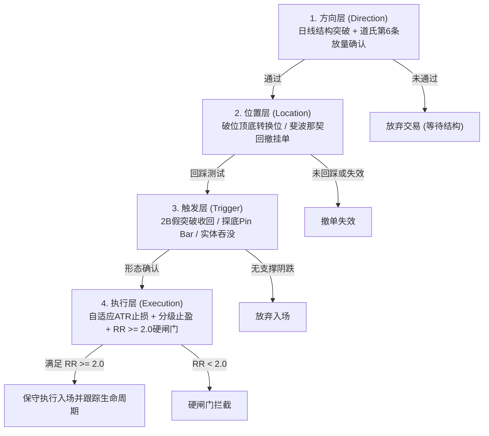

# Investment Assistant · 价格行为学量化与多层级交易策略系统

基于经典价格行为学（Price Action / 道氏理论 / 结构突破 / 裸K形态）与现代量化风控工程的严谨交易研究与回测系统。

---

## 目录结构

```text
Investment_Assistant/
├── config/                  # 标的清单与配置
│   ├── tickers.txt          # 美股股票池 (30 只核心标的)
│   └── tickers_crypto.txt   # 加密货币标的池
├── data/                    # 历史行情数据本地缓存与元数据
│   ├── _meta.json           # 数据拉取留痕、来源与数据质量校验记录
│   └── *.csv                # 日线 / 周线历史 K 线数据
├── docs/                    # 策略理论规范与全周期实证研究报告
│   ├── strategy_theory.md   # 核心交易理论体系与层级规范
│   ├── strategy_crypto.md   # 加密资产专用策略研究与回测报告
│   ├── backtest_protocol.md # H1 方向层预注册协议
│   ├── backtest_protocol_v2.md # H2 结构突破预注册协议
│   ├── backtest_result_v1.md   # H1 计数模式实证分析报告
│   ├── backtest_result_v2.md   # H2 突破与放量确认实证报告
│   ├── backtest_result_v3.md   # 四层级全闭环风控实证报告
│   └── pa_engine_audit_2026-10-22.md # 早期价格行为引擎审计记录
├── results/                 # 回测生成的结构化指标与执行日志
│   ├── backtest_*.json      # 各轮次回测指标导出 (JSON 格式)
│   └── backtest_*.log       # 完整回测控制台输出留痕
├── tests/                   # 自动化单元测试与无未来函数自检套件
│   ├── __init__.py          # 测试环境路径自适应引导
│   ├── test_data_sources.py # 数据源离线解析与熔断机制测试
│   ├── test_pa_engine_fixes.py # 价格行为引擎修复项回归测试
│   ├── test_strategy_h2.py  # H2 结构突破与位移去重测试
│   ├── test_strategy_layers.py # 位置层/触发层/风控闭环综合测试
│   ├── test_strategy_crypto.py # 加密专用策略/2B扫损/分级止盈测试
│   └── test_wave_dow_engine.py # 道氏相互印证与艾略特波浪位置测试
├── backtest.py              # Walk-Forward 回测引擎与 T1~T11 数学验证
├── data_sources.py          # 多源行情拉取、降级、连续性校验适配器
├── pa_engine.py             # 价格行为学核心分析引擎 (Swing/Dow/MSS/Levels)
├── strategy_layer.py        # 美股位置层挂单、触发层形态与执行层全闭环推演
├── strategy_crypto.py       # 加密资产专用策略引擎 (2B猎杀/宽止损/分级止盈/资产解耦)
└── README.md                # 项目架构与快速上手指南
```

---

## 四层级联立策略架构

系统严格遵循“分层设计、不许打包”原则（详见 `docs/strategy_theory.md` 与 `docs/strategy_crypto.md`）：



---

## 快速上手与常用命令

### 1. 运行完整单元测试套件 (45 项测试 100% PASS)
```bash
python -m unittest discover tests
```

### 2. 执行零未来函数数学自检 (T1~T11 项严格检验 100% PASS)
```bash
python backtest.py --verify
```

### 3. 数据拉取与缓存状态检查
```bash
# 查看本地数据缓存状态
python data_sources.py --status

# 拉取美股核心股票池日线
python data_sources.py --fetch-file tickers.txt --bars 1600
```

### 4. 运行全闭环策略对比回测 (市价追入 vs 限价回踩 vs 闭环风控 vs 加密专用)
```bash
# 标的股票池全量对比
python backtest.py --tickers-file tickers.txt --offline --volume-filter --compare

# 指数 ETF (SPY / QQQ) 对比检验
python backtest.py --tickers SPY,QQQ --offline --volume-filter --compare

# 比特币全周期对比回测 (美股原装模式 vs 加密专用策略)
python backtest.py --tickers BTC-USD --offline --compare --json results/backtest_btc_compare.json
```

